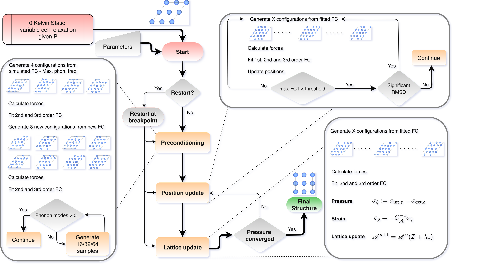

# WARP

{ align=right width="180" }

WARP — **W**yckoff-constrained **A**nharmonic **R**elaxation at **P**ressure and temperature —
relaxes a crystal structure at a chosen temperature and a chosen external stress. It is built on
the temperature-dependent effective potential (TDEP) method and takes its forces from Quantum
ESPRESSO, VASP or a machine-learned interatomic potential. This page explains what the relaxation
means, how the loop is put together, and where to go next.

## What WARP does

An ordinary variable-cell relaxation finds the minimum of the potential energy: the structure a
crystal would have if its nuclei stood still. A real crystal never does. Its nuclei move, even at
absolute zero, and the structure seen in an experiment is the minimum of the *free* energy at the
temperature and pressure of that experiment.

WARP finds that structure directly. It drives two residuals to zero at once:

- the **mean force** on every atom, averaged over a thermal ensemble of displaced supercells, and
- the **full internal stress** of that ensemble, compared with the requested external stress.

Both quantities are measured on configurations sampled from the current effective force
constants. With `--quantum` the sampling uses Bose–Einstein statistics, so the zero-point motion
is present from the first step; without it the sampling is classical. In either case the
anharmonic contributions are sampled rather than expanded in perturbation theory. Nothing is
frozen: the reference positions, the cell shape and the cell volume all move.

## How the structure keeps its symmetry

Averages over a finite ensemble carry noise, and noise is not symmetric. Applied step after step,
it would walk a symmetric crystal down to a lower-symmetry structure.

WARP does not rely on a tolerance to stop that. Every update is projected onto the manifold the
current space group allows before it is applied:

- **positions** are projected onto the free Wyckoff parameters of each occupied orbit, and every
  member of the orbit is regenerated from the updated parameters by its own symmetry operation;
- **strains** are projected onto the strains invariant under the point group of the current cell,
  the group average that Neumann's principle permits.

The part that is projected away is not discarded silently: its size measures the sampling noise of
the run, and it is printed at every step. Because the invariant subspace of a supergroup lies
inside that of the subgroup, the projections never block a **rise** in symmetry. The projected
strain keeps the space group of the cell exactly, so no separate symmetrisation step follows a
lattice update. A position update that would leave a different space group stops the run
(`[guardrail:spacegroup]`), so symmetry cannot fall. The space group of each step is taken from
its starting structure at a tolerance of 10⁻⁵ Å: a structure that is already that close to a
higher-symmetry group when a step begins continues in that group, whereas a rise completed
within a single position update stops the run as well.

## Where the forces come from

WARP never computes a force itself. It writes one Quantum ESPRESSO input per sampled configuration
and hands it to a calculator command, so the force engine is one of

- **Quantum ESPRESSO**: any `pw.x` command line, with the pseudopotentials, cutoffs and k-point
  mesh of the master input deck;
- **VASP**: one single point per configuration, run through `warpt.VASP_interface` from a
  template directory holding `INCAR`, `KPOINTS` (unless `INCAR` sets `KSPACING`) and one
  `POTCAR_<element>` file per element; or
- **a machine-learned interatomic potential**: a UPET or MACE model evaluated through
  `warpt.MLIP_interface`.

The VASP and machine-learned backends print their energies, forces and stresses in the same
format as Quantum ESPRESSO, so every parser downstream is unchanged. A machine-learned potential
costs orders of magnitude less per configuration, which is what makes the large ensembles of a
low-temperature quantum run affordable. See [Force engines](forces.md).

## The loop

{ width="100%" }

A run begins with a **preconditioning** schedule that bootstraps a usable set of force constants
from a model set scaled to a Debye temperature or a maximum phonon frequency, growing the
ensemble until the phonon spectrum has no imaginary modes and the fit cross-validates. It then
alternates:

1. **position steps** — sample, fit the force constants, read off the residual force, apply the
   Wyckoff-projected displacement, and repeat until both the mean and the maximum residual force
   are below tolerance;
2. **one lattice step** — sample, fit, assemble the internal stress, apply the symmetry-projected
   elastic strain, and restore the exact space group of the new cell.

The run stops when the stress residual, the change in the phonon stress since the previous lattice
step and the size of the previous lattice step are all within tolerance. The whole tree is written
to disk stage by stage, so a run killed by a scheduler continues where it stopped when it is
started again with the same command in the same directory.

## Where to go next

| Topic | Page |
| --- | --- |
| Installing WARP and its external programs | [Installation](installation.md) |
| The smallest complete run | [Quick start](quickstart.md) |
| The files to prepare before a run | [Input files](inputs.md) |
| The equations behind each update | [Method](method.md) |
| Every command-line option | [Command line](cli.md) |
| What a run writes, and how it resumes | [Run directory and resume](run-directory.md) |
| Choosing between DFT and a potential | [Force engines](forces.md) |
| Converting structures between POSCAR and Quantum ESPRESSO | [Structure converter](structconv.md) |
| Concurrency, batching and timing output | [Environment variables](environment.md) |
| Running under a batch scheduler | [Running on a cluster](hpc.md) |
| Decoding an error message | [Troubleshooting](troubleshooting.md) |
| The API of a single module | [Module reference](reference/index.md) |
| Citing the method | [Citing WARP](citing.md) |

!!! note "Cite WARP"
    H. R. A. ten Eikelder, F. Knoop and F. Trybel, *Finite temperature and pressure structural relaxations including zero-point motion and anharmonicity*, arXiv:2611.12736 (2026), <https://arxiv.org/abs/2611.12736>.
