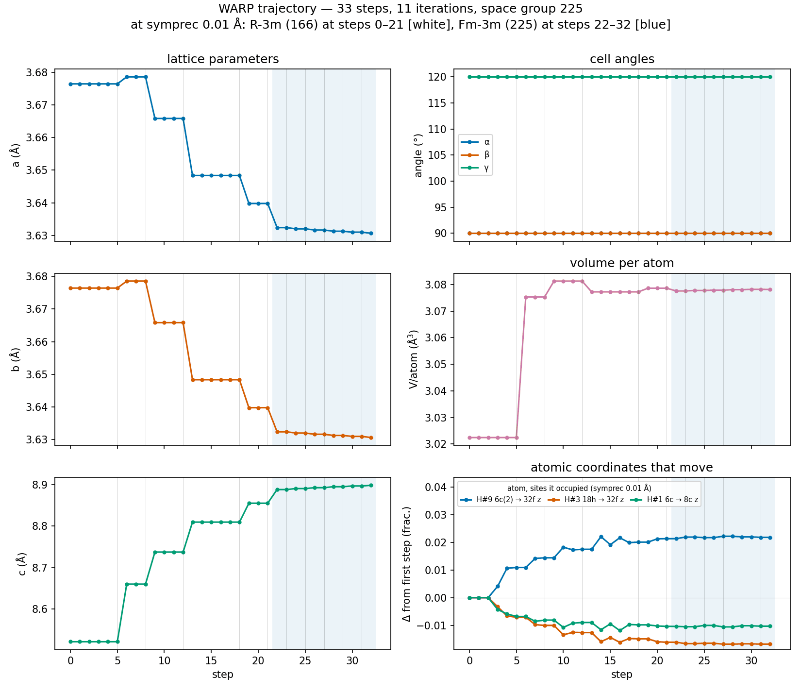
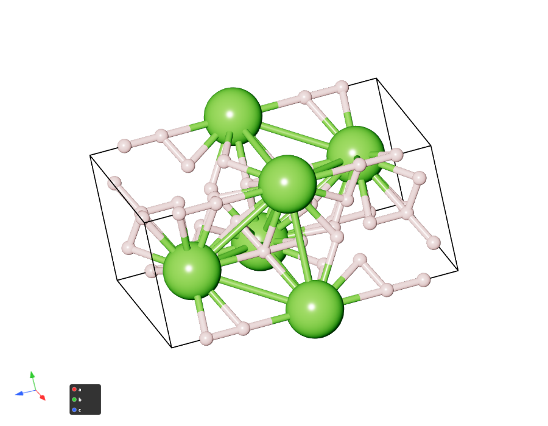
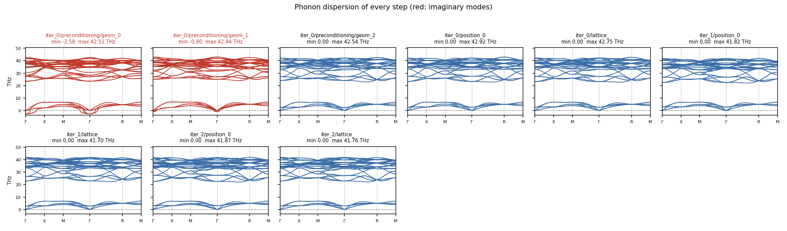
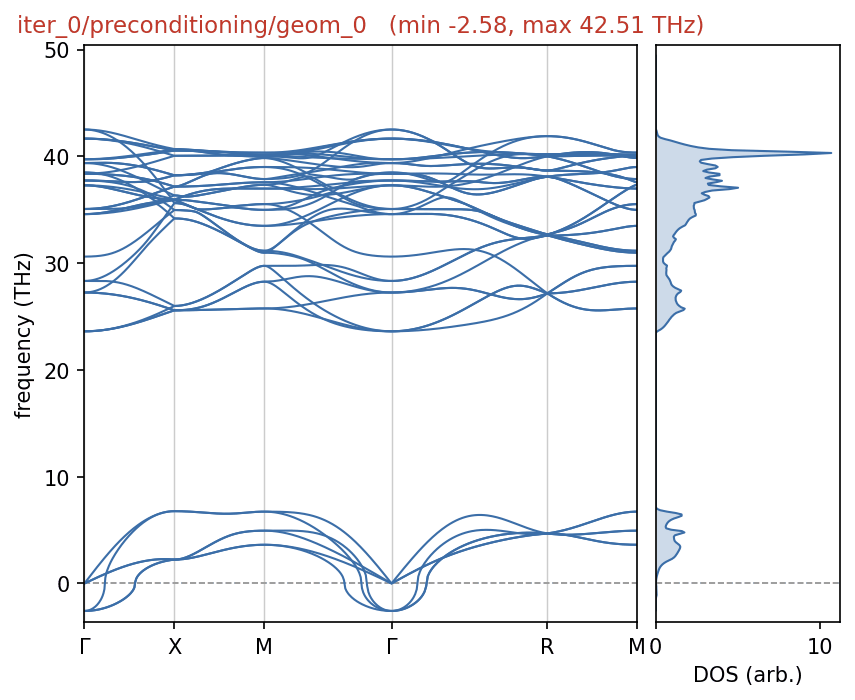
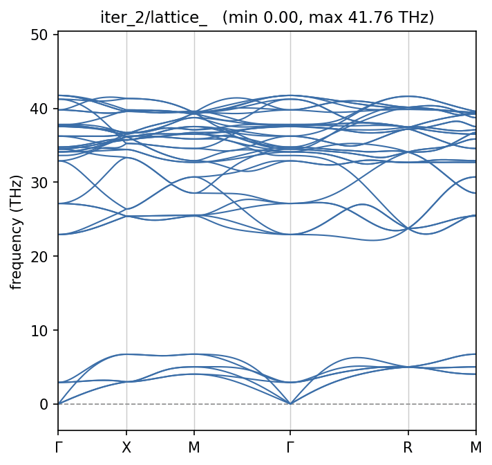
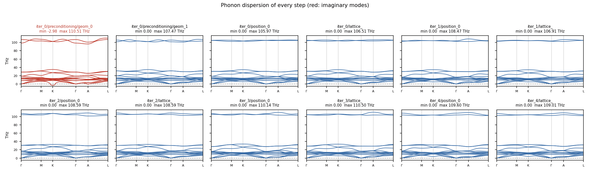
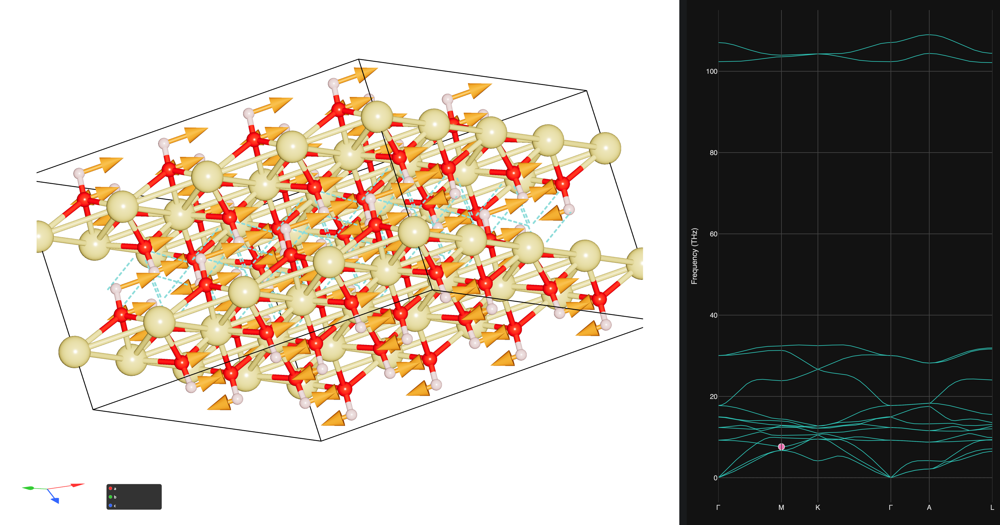
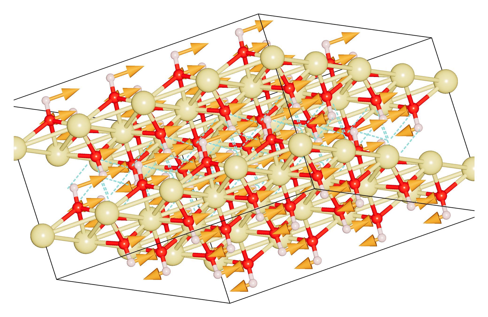

# Post-processing showcase

A finished run directory holds every step WARP took: the structure, the samples, the force
constants and the phonons of each one. Four commands turn that tree into figures. This page runs
them one after the other and shows what each one writes. Every command is run from the run root,
the directory WARP was launched in.

The runs used here use forces from fine-tuned UPET potentials, with quantum statistics:

- **LaH10** at 150 GPa and 293 K, started in $R\bar{3}m$ (space group 166) with 33 atoms in the
  hexagonal cell. On its way, the structure moves towards cubic $Fm\bar{3}m$ (space group 225).
- **LaH6** at 115 GPa and 293 K, $Im\bar{3}m$, 14 atoms in the cubic cell: a short run.
- **Brucite**, Mg(OH)₂, at 0 GPa, $P\bar{3}m1$, 5 atoms: a layered crystal, at 75 K and at 15 K.

The runs themselves are not part of the repository.

## 1. Follow the structure: `warpt.trajectory`

```bash
python3 -m warpt.trajectory .
```

```text
[trajectory] 33 steps -> warpt_trajectory.csv
[trajectory] target 150 GPa | last 5 lattice steps: 0.399  0.321  0.378  0.265  0.174 GPa residual
[trajectory] |Δσ_ph| last 5: 1.821  2.352  1.119  1.568  1.464 GPa
[trajectory] latest: iter_10 position_0 | V/atom 3.0781 | c/a 2.4508 | spg 225 (to symprec 0.004)
[trajectory] occupied orbits with a moving DoF (5 found, tracking 3):
    H#9 6c(2) → 32f z  total drift 0.02224 frac
    H#3 18h → 32f z    total drift 0.01686 frac
    H#1 6c → 8c z      total drift 0.01193 frac
[trajectory] wrote warpt_trajectory.png
```

`warpt_trajectory.csv` holds one row per step. `warpt_trajectory.png` shows the cell and the
atoms step by step:



c grows and a shrinks until c/a reaches 2.451, close to $\sqrt{6} = 2.449$, the value of a cubic
cell in this hexagonal setting. The background is tinted by the space group of each step at
symprec 0.01 Å, as listed under the title: $R\bar{3}m$ up to step 21, $Fm\bar{3}m$ from step 22.
A run that passes through more groups, for example monoclinic, then tetragonal, then cubic, gets
one tint per group.

The coordinates panel follows one atom per symmetry orbit, in the cell of the run, so its curves
stay continuous when the space group changes. Each atom is named by its element and number in
the file, and by every Wyckoff site it occupied: H#9 and H#3 start on two different orbits of
$R\bar{3}m$ (6c and 18h) that merge into the 32f orbit of $Fm\bar{3}m$, and H#1 moves from 6c onto
8c. Vertical lines mark the lattice steps. Column by column, the CSV is described under
[Run directory and resume](run-directory.md#the-trajectory-csv).

## 2. Collect the frames and check their symmetry: `warpt.get_frames`

```bash
python3 -m warpt.get_frames -r .
```

```text
frame                                               symprec 1e-5      symprec 1e-4      symprec 1e-3      symprec 1e-2
frame_0000_iter_0_preconditioning_geom_0.vasp           166 R-3m          166 R-3m          166 R-3m          166 R-3m
...
frame_0021_iter_4_lattice.vasp                          166 R-3m          166 R-3m          166 R-3m          166 R-3m
frame_0022_iter_5_position_0.vasp                       166 R-3m          166 R-3m          166 R-3m         225 Fm-3m
...
frame_0031_iter_9_lattice.vasp                          166 R-3m          166 R-3m          166 R-3m         225 Fm-3m
Wrote trajectory.xyz with 32 frames
```

Every frame is the updated unit cell of one step. It is written as a POSCAR named after its step,
with the step as its title line, and all frames together go to `trajectory.xyz`. Each line of the
table gives the space group of one frame at four tolerances (`--symprec` sets others). From
`iter_5` on, the structure is $Fm\bar{3}m$ to within 0.01 Å, but it stays $R\bar{3}m$ at 1e-3 Å and
tighter: WARP updates the structure within the symmetry of its start, so a higher group is
approached but not imposed. The groups are also stored in `trajectory.xyz` (`spg_1e-2=225`, ...),
next to the step (`step=iter_5/position_0`).

[CrysViz](https://crysviz.org) opens `trajectory.xyz` as one structure with all its frames and
plays the relaxation back; a single frame opens the same way:

```bash
crysviz trajectory.xyz
crysviz frame_0031_iter_9_lattice.vasp
```

{ width="460" }

## 3. Look at the phonons of every step: `warpt.plot_phonons_iter`

```bash
python3 -m warpt.plot_phonons_iter .
```

On the LaH6 run:

```text
step                                min freq (THz)  max freq (THz)
iter_0/preconditioning/geom_0               -2.581          42.514   imaginary modes
iter_0/preconditioning/geom_1               -0.800          42.939   imaginary modes
iter_0/preconditioning/geom_2                0.000          42.545
...
iter_2/lattice_                              0.000          41.758
[plot_phonons_iter] 9 steps, 2 with imaginary modes -> phonon_plots/
```

`phonon_plots/overview.png` has the dispersion of every step on one frequency axis. Steps with
imaginary modes are drawn in red, and each title gives the lowest and highest frequency:



The first two preconditioning geometries have imaginary branches around Γ. From the third one
on, every step is stable. Next to the overview, every step has a figure of its own, with the
phonon DOS beside the dispersion when the step computed one:

<div class="grid" markdown>





</div>

On the brucite run at 75 K, the O–H stretch near 105–110 THz sits far above the lattice modes.
Only the first preconditioning geometry has imaginary modes, and the run converges after five
iterations:



`--overview-only` skips the per-step figures, and `--imag-tol` sets the threshold below which a
frequency counts as imaginary (0.05 THz by default). Steps that kept only TDEP's text output
(`outfile.dispersion_relations` without the `.hdf5`) are read from that.

## 4. Animate the modes of one step: `warpt.band_yaml` and CrysViz

```bash
python3 -m warpt.band_yaml iter_<n>/lattice_
crysviz iter_<n>/lattice_/band.yaml
```

`<n>` is the iteration of the step to animate, here the last one of the run.

The first command converts the step's `outfile.dispersion_relations.hdf5` into the `band.yaml`
format that phonopy writes. It carries the q-path, the frequencies and the eigenvectors, so any
program that reads phonopy band structures can use it. `phonopy-bandplot band.yaml` draws it, and
`--band-yaml` on `plot_phonons_iter` writes one for every step. A step from an older run that
kept only the text output gets its `.hdf5` back from TDEP: copy the step's `outfile.forceconstant`
to `infile.forceconstant` next to `infile.ucposcar` and run `phonon_dispersion_relations` there.
CrysViz shows the band structure
next to the structure, and a click on a band animates that mode:



Both images show the last lattice step of the brucite run at 75 K in a 4×4×2 supercell, set with
the supercell fields of the phonon panel so that a mode away from Γ shows its full pattern: here
the 7.6 THz mode at the M point, drawn as arrows on the Mg(OH)₂ sheets; the dashed lines are the
O–H···O contacts between the sheets. The structure below is CrysViz's own PNG export (Download →
PNG), which renders at any resolution:



A `band.yaml` does not record its length unit, so CrysViz asks for it when the file is opened. The
cell is in Å, which CrysViz also detects.

All options of the four tools are listed under [Command line](cli.md).
